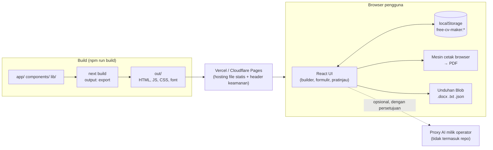
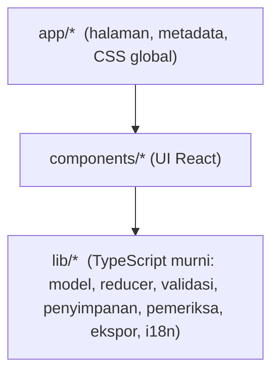
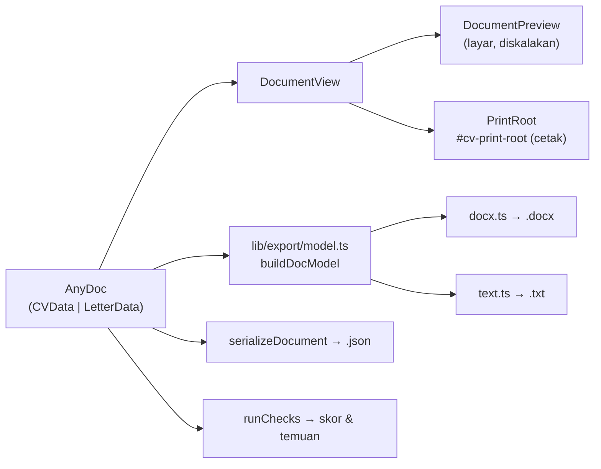
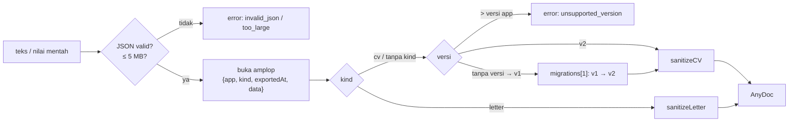
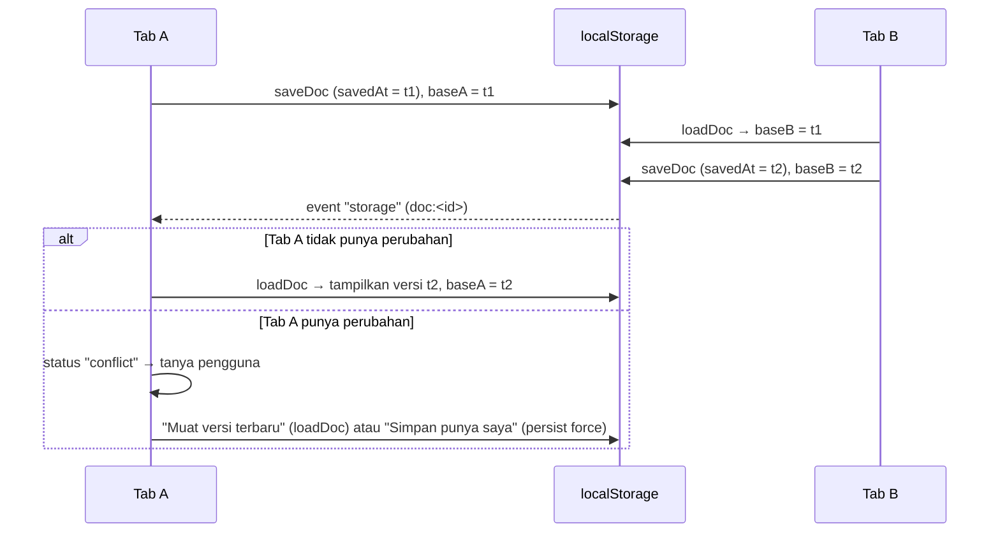
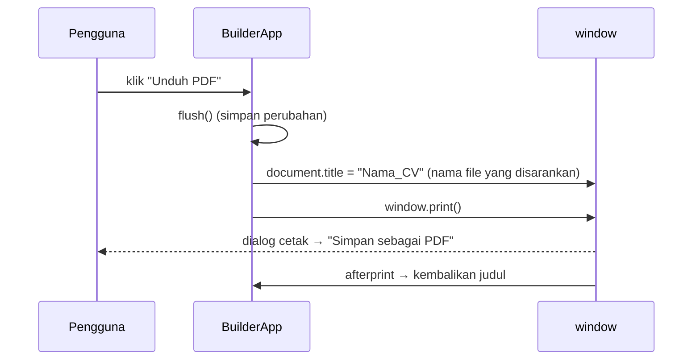
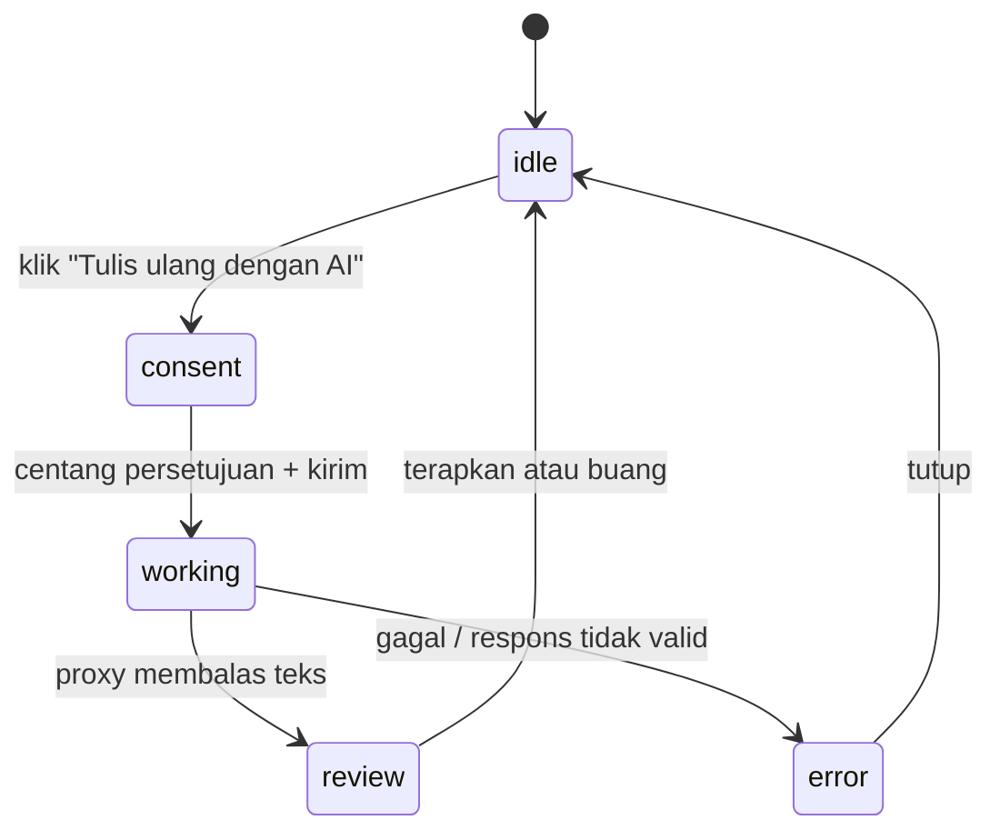

# Dokumen Teknis Free AI CV Maker

Dokumen ini menjelaskan arsitektur, model data, alur data, dan keputusan teknis proyek. Pembacanya adalah developer yang akan merawat atau mengembangkan kode ini. Untuk penjelasan non-teknis, baca [PANDUAN-PROYEK.md](./PANDUAN-PROYEK.md). README di akar repositori memuat ringkasan fitur dan langkah deploy.

Dokumen ini ditulis berdasarkan kode di `main` setelah [PR #2](https://github.com/fallords/AI-CV-Maker/pull/2) digabung (commit `2350150`).

---

## Daftar isi

1. [Prinsip dan batasan](#1-prinsip-dan-batasan)
2. [Tumpukan teknologi](#2-tumpukan-teknologi)
3. [Arsitektur](#3-arsitektur)
4. [Struktur direktori dan tanggung jawab modul](#4-struktur-direktori-dan-tanggung-jawab-modul)
5. [Rute dan rendering](#5-rute-dan-rendering)
6. [Model data](#6-model-data)
7. [Validasi, sanitasi, dan migrasi](#7-validasi-sanitasi-dan-migrasi)
8. [State editor](#8-state-editor)
9. [Penyimpanan multi-dokumen](#9-penyimpanan-multi-dokumen)
10. [Autosave dan konflik antar-tab](#10-autosave-dan-konflik-antar-tab)
11. [Urutan dan visibilitas bagian](#11-urutan-dan-visibilitas-bagian)
12. [Template dan gaya dokumen](#12-template-dan-gaya-dokumen)
13. [Pratinjau A4 dan hitungan halaman](#13-pratinjau-a4-dan-hitungan-halaman)
14. [Ekspor PDF](#14-ekspor-pdf)
15. [Ekspor Word, teks, dan JSON](#15-ekspor-word-teks-dan-json)
16. [Pemeriksa CV](#16-pemeriksa-cv)
17. [Internasionalisasi (i18n)](#17-internasionalisasi-i18n)
18. [AI opsional](#18-ai-opsional)
19. [Keamanan dan privasi](#19-keamanan-dan-privasi)
20. [Aksesibilitas](#20-aksesibilitas)
21. [Sistem desain situs](#21-sistem-desain-situs)
22. [Pengujian](#22-pengujian)
23. [Build, deploy, dan konfigurasi](#23-build-deploy-dan-konfigurasi)
24. [Resep perubahan umum](#24-resep-perubahan-umum)
25. [Keputusan desain](#25-keputusan-desain)
26. [Keterbatasan dan catatan terbuka](#26-keterbatasan-dan-catatan-terbuka)

---

## 1. Prinsip dan batasan

Aturan berikut berlaku di seluruh kode. Perubahan baru tidak boleh melanggarnya.

| Prinsip | Wujudnya di kode |
| --- | --- |
| Gratis, tanpa langganan, iklan, atau watermark | Tidak ada gerbang fitur. Ekspor tidak menambahkan tanda apa pun. |
| Tanpa backend | `output: "export"` di `next.config.ts`. Tidak ada API route, server action, atau database. |
| Data CV tidak meninggalkan perangkat | Penyimpanan hanya di `localStorage`. CSP `connect-src 'self'`. Tidak ada analitik. |
| Isi CV tidak pernah di-log | Tidak ada `console.*` yang mencetak isi dokumen. |
| Tidak mengarang fakta | Pesan pemeriksa CV dan prompt AI hanya meminta detail yang dimiliki pengguna. Prompt AI melarang mengarang pengalaman, kredensial, atau angka. |
| Tidak ada kunci API di frontend | AI hanya lewat proxy milik operator. Nilai `NEXT_PUBLIC_*` dianggap publik. |
| AI mati secara default | `getAIProvider()` mengembalikan `null` tanpa `NEXT_PUBLIC_AI_PROXY_URL` (https). |
| Aksesibel (WCAG 2.1 AA) | Landmark, label, fokus terlihat, dialog native, dan pemindaian axe di e2e. |
| Dua bahasa | Bahasa UI (EN/ID) terpisah dari bahasa dokumen. |

---

## 2. Tumpukan teknologi

| Lapisan | Teknologi | Catatan |
| --- | --- | --- |
| Framework | Next.js 16.4.0 (App Router, Turbopack) | Ekspor statis. Baca `node_modules/next/dist/docs/` sebelum memakai API Next, karena versi ini punya perubahan yang memutus kompatibilitas (lihat `AGENTS.md`). |
| UI | React 19.3 | Komponen klien (`"use client"`) untuk semua bagian interaktif. |
| Bahasa | TypeScript (`strict: true`) | `npm run typecheck`. `next build` juga gagal jika ada error tipe. |
| Gaya | Tailwind CSS 4 (`@theme` di `app/globals.css`) | Tailwind untuk UI situs. Dokumen CV memakai CSS biasa dalam satuan fisik (mm/pt). |
| Font | `@fontsource/ibm-plex-sans`, `-serif`, `-mono` | Di-bundle, tidak ada CDN font. |
| Word | `docx` 9.10 | Dimuat dengan `import()` dinamis saat pertama kali dibutuhkan. |
| Unit test | Vitest 5, Testing Library, jsdom | `tests/unit/**/*.test.{ts,tsx}` |
| E2E | Playwright 1.56.1, `@axe-core/playwright` | Diuji pada build statis di `out/`. |
| Lint | ESLint 9, `eslint-config-next` 16.4.0 | `npm run lint` |
| Runtime | Node.js ≥ 20.9 (`.nvmrc`: 22) | Hanya untuk build dan tes. Situsnya sendiri tidak butuh Node. |

Dependensi runtime hanya `next`, `react`, `react-dom`, `docx`, dan paket `@fontsource`. `jszip` adalah dev dependency untuk membongkar `.docx` di tes.

---

## 3. Arsitektur

### 3.1 Gambaran besar



Server hanya menyajikan file statis. Seluruh logika aplikasi berjalan di browser.

### 3.2 Lapisan kode



- **`lib/`** hampir seluruhnya fungsi murni tanpa React. Pengecualiannya `lib/i18n/index.tsx` (provider React) serta akses `localStorage` dan `window` di `storage.ts`, `documents.ts`, `pdf.ts`, dan `export/download.ts`. Logika inti diuji langsung di sini.
- **`components/`** memanggil `lib/` dan tidak menyimpan aturan bisnis sendiri. Contohnya, urutan bagian selalu berasal dari `lib/cv-sections.ts`, baik untuk formulir, template, ekspor, maupun pemeriksa.
- **`app/`** hanya kerangka halaman dan metadata. Isinya dirender oleh komponen klien.

### 3.3 Satu sumber kebenaran untuk tampilan dokumen



Pratinjau dan PDF memakai komponen yang sama (`DocumentView`), sehingga yang dilihat pengguna sama dengan yang dicetak. Word dan teks memakai model ekspor yang sama, sehingga keduanya selalu konsisten.

---

## 4. Struktur direktori dan tanggung jawab modul

### `app/`

| File | Isi |
| --- | --- |
| `layout.tsx` | Root layout: metadata, `viewport.themeColor`, impor CSS font Plex, `I18nProvider`. |
| `globals.css` | Token tema situs (`@theme`), fokus, gaya dokumen CV dan surat (`.cv-*`, `.tpl-*`), dan aturan cetak A4. |
| `page.tsx`, `builder/page.tsx`, `help/page.tsx`, `privacy/page.tsx` | Kerangka tiap rute dengan metadata. Isinya dari `components/pages/*` atau `BuilderApp`. |
| `icon.svg` | Favicon. |

### `components/`

| Folder / file | Tanggung jawab |
| --- | --- |
| `builder/BuilderApp.tsx` | Inti builder. Menyimpan dokumen yang terbuka (`docReducer`), memuat dan memigrasi data saat mount, autosave, flush, konflik antar-tab, toolbar (pemilih dokumen, template, bahasa, unduh), tab editor (Isi/Desain/Periksa), tab ponsel (Ubah/Pratinjau), lompatan dari pemeriksa, dan `PrintRoot`. |
| `builder/DocumentsDialog.tsx` | Dialog "Dokumen Anda": buka, ganti nama, gandakan, hapus, CV atau surat baru, impor JSON. Juga `RenameDialog`. |
| `builder/DownloadMenu.tsx` | Tombol Unduh PDF dan menu "Semua format" (Word, teks, cadangan JSON). |
| `builder/DesignPanel.tsx` | Pengaturan aksen, font, ukuran, jarak, margin, dan pengelola bagian (urutkan, sembunyikan, reset). |
| `builder/ChecksPanel.tsx` | Skor dan daftar temuan pemeriksa, dikelompokkan per tingkat. Tiap temuan bisa diklik untuk melompat. |
| `builder/MenuButton.tsx`, `Tabs.tsx` | Menu dan tab yang aksesibel. |
| `builder/print.ts` | `printDocument(doc)`: mengatur judul halaman (nama file PDF) lalu memanggil `window.print()`. |
| `builder/doc-names.ts` | Nama salinan ("… (copy)") dan nama otomatis yang mengikuti isi. |
| `cv-form/*` | Editor tiap bagian CV. `CVForm` merender bagian sesuai `allSectionsInOrder`. `EntryList` dan `RepeatableSection` menangani entri berulang (tambah, hapus dengan konfirmasi, naik/turun). `AiSummaryAssist` adalah UI AI opsional. |
| `letter/LetterForm.tsx` | Editor surat lamaran. |
| `cv-preview/DocumentPreview.tsx` | Pratinjau A4 yang diskalakan, garis batas halaman, dan hitungan halaman. `CVPreview` adalah pembungkus lama. |
| `templates/*` | `AtsMinimal`, `ModernProfessional`, `Graduate`, `parts.tsx` (perender bagian bersama), `LetterDocument`, `DocumentView`, `PrintRoot`, `style.ts` (DocStyle ke variabel CSS), `index.tsx` (registri `TEMPLATES`). |
| `layout/*` | `SiteHeader` (wordmark, navigasi, tombol EN/ID) dan `SiteFooter` (kontak hanya jika env diisi). |
| `pages/*` | Isi klien halaman utama, Bantuan, dan Privasi. |
| `ui/*` | `Dialog` (`<dialog>` native, `ConfirmDialog`), `Field` (input berlabel dengan `data-field`), `MonthField`, `Icons`, kelas bersama (`styles.ts`). |

### `lib/`

| File | Tanggung jawab |
| --- | --- |
| `cv-schema.ts` | Tipe `CVData` v2, konstanta (template, bahasa, level), `createEmptyCV`, `emptyItem`, `createId`, `isValidId`, helper isi (`isItemFilled`, `isCVEmpty`, …). |
| `cv-sections.ts` | Kunci bagian, urutan default per template, resolusi urutan dan visibilitas, `sectionDomId`, `isSectionFilled`. |
| `cv-reducer.ts` | Transisi state CV yang murni. |
| `cv-validation.ts` | Sanitasi, migrasi skema, parse dan serialisasi JSON (CV dan surat), validator email, URL, dan rentang tanggal, `safeHref`. |
| `cv-format.ts` | Label di dalam dokumen per bahasa dokumen (`CV_LABELS`), format bulan dan rentang, `toBlocks` (teks ke paragraf dan poin). |
| `cv-checks.ts` | Pemeriksa CV berbasis aturan dan skor. |
| `doc-style.ts` | Model tampilan (`DocStyle`), preset, ukuran, sanitasi, kontras WCAG, warna template. |
| `letter-schema.ts`, `letter-reducer.ts` | Model surat lamaran, default, sanitasi, baris tanggal, dan reducer-nya. |
| `documents.ts` | Penyimpanan multi-dokumen di `localStorage`, perbaikan indeks, migrasi draf lama. |
| `storage.ts` | Akses aman ke `localStorage`, deteksi kuota, preferensi, hapus semua data, pembaca draf v1. |
| `pdf.ts` | Nama file PDF yang aman, `printWithTitle`. |
| `export/model.ts` | Model konten dokumen yang netral format. |
| `export/docx.ts`, `export/text.ts`, `export/download.ts` | Perender Word dan teks, serta unduhan Blob. |
| `sample-cv.ts` | Data contoh yang jelas fiktif (untuk pratinjau dan tes). |
| `i18n/*` | Kamus `en.ts`/`id.ts`, kamus per fitur (`features/*.{en,id}.ts`), provider dan `fmt`. |
| `ai/provider.ts`, `ai/prompts.ts` | Kontrak penyedia AI, proxy HTTP, dan template prompt. |

---

## 5. Rute dan rendering

| Rute | Halaman | Komponen isi |
| --- | --- | --- |
| `/` | Halaman utama | `components/pages/LandingContent.tsx` |
| `/builder/` | Builder CV dan surat | `components/builder/BuilderApp.tsx` |
| `/help/` | Bantuan, termasuk langkah PDF per browser | `components/pages/HelpContent.tsx` |
| `/privacy/` | Pemberitahuan privasi dan "Hapus semua data lokal" | `components/pages/PrivacyContent.tsx` |
| (lainnya) | `out/404.html` | Bawaan Next |

- `trailingSlash: true` menghasilkan `/builder/index.html` dan seterusnya, yang dilayani dengan andal oleh host statis.
- HTML statis dirender dalam **bahasa Inggris**. `I18nProvider` menerapkan preferensi bahasa setelah hydration (lihat §17).
- Semua yang membaca `localStorage` berjalan di `useEffect` setelah mount, sehingga build statis tidak menyentuh `window`.

---

## 6. Model data

### 6.1 Dokumen

```ts
type AnyDoc = { kind: "cv"; data: CVData } | { kind: "letter"; data: LetterData };
```

### 6.2 `CVData` (skema v2, `lib/cv-schema.ts`)

| Field | Tipe | Catatan |
| --- | --- | --- |
| `schemaVersion` | `2` | `CV_SCHEMA_VERSION` |
| `meta.template` | `"ats-minimal" \| "modern-professional" \| "graduate"` | |
| `meta.cvLanguage` | `"en" \| "id"` | Bahasa judul dan tanggal di dalam CV |
| `meta.sectionOrder` | `SectionKey[]` | `[]` berarti urutan default template |
| `meta.hiddenSections` | `SectionKey[]` | Isinya tetap disimpan, hanya tidak dirender |
| `meta.style` | `DocStyle` | Lihat §12 |
| `personal` | `fullName, title, email, phone, city, country, linkedin, website, photo` | `photo` berupa URL `data:image/*` |
| `summary` | `string` | |
| `experience[]` | `id, jobTitle, company, location, startDate, endDate, current, description` | |
| `education[]` | `id, institution, degree, field, startDate, endDate, description` | |
| `projects[]` | `id, name, role, description, technologies, url` | |
| `technicalSkills[]`, `softSkills[]` | `id, name, level` | `level`: `"" \| beginner \| intermediate \| advanced \| expert` |
| `certifications[]` | `id, name, issuer, issueDate, credential` | |
| `languages[]` | `id, name, level` | `level`: `"" \| basic \| conversational \| professional \| fluent \| native` |
| `organizations[]` | `id, role, organization, location, startDate, endDate, current, description` | |
| `awards[]` | `id, title, issuer, date, description` | |
| `references[]` | `id, name, position, organization, email, phone, relationship` | |
| `interests[]` | `id, name` | |
| `customSections[]` | `id, title, items: CustomItem[]` | `CustomItem`: `id, title, subtitle, startDate, endDate, description` |

Konvensi:

- **Tanggal** disimpan sebagai `"YYYY-MM"`, `"YYYY"` (hanya tahun), atau `""`. `formatMonth` menampilkannya sesuai bahasa dokumen tanpa memakai API locale, supaya hasilnya deterministik.
- **Deskripsi**: satu poin per baris. Baris yang diawali `-`, `•`, atau `*` menjadi butir daftar (`toBlocks`).
- **Id** harus 1–64 karakter `[\w-]` dan tidak boleh `__proto__`, `constructor`, atau `prototype` (`isValidId`). `createId()` memakai `crypto.randomUUID` ditambah penghitung.
- **Entri kosong tidak dirender.** Sebuah entri dianggap terisi jika ada field string non-kosong selain `id` dan `level` (`isItemFilled`).
- `ListSection` adalah nama-nama array entri di atas. Bagian kustom ditangani terpisah.

### 6.3 `LetterData` (`lib/letter-schema.ts`, `LETTER_SCHEMA_VERSION = 1`)

| Field | Isi |
| --- | --- |
| `kind` | `"letter"` |
| `meta` | `template`, `language`, `style` |
| `sender` | `fullName, title, email, phone, city, country, linkedin, website`. Bisa disalin dari CV lewat `senderFromCV`. |
| `recipient` | `name, title, company, address` (multi-baris) |
| `date` | `"YYYY-MM-DD"` atau `""` |
| `subject`, `greeting`, `body`, `closing`, `signature` | Isi `body` dipisah per paragraf dengan baris kosong |

Default salam: EN "Dear Hiring Manager," / "Kind regards,". ID "Yth. Bapak/Ibu HRD," / "Hormat saya,". Surat berbahasa Indonesia menaruh kota pengirim sebelum tanggal (`letterDateLine`).

### 6.4 Batas ukuran

| Batas | Nilai | Lokasi |
| --- | --- | --- |
| Ukuran file impor | 5 MB | `MAX_IMPORT_BYTES` (`cv-validation.ts`) |
| Teks panjang / teks pendek | 5000 / 300 karakter | `MAX_TEXT` / `MAX_SHORT` |
| Entri per daftar | 100 | `MAX_ITEMS` |
| Bagian kustom / entri per bagian kustom | 20 / 100 | `MAX_CUSTOM_SECTIONS` / `MAX_CUSTOM_ITEMS` |
| Foto tersimpan | ≤ 2.000.000 karakter data URL | `MAX_PHOTO_CHARS` |
| Foto unggahan | PNG/JPEG/WebP ≤ 10 MB, diubah ke JPEG 360 px (kualitas 0,85) | `PersonalSection.tsx` |
| Field surat / alamat / isi | 300 / 1000 / 10.000 | `letter-schema.ts` |
| Nama dokumen | 120 karakter | `MAX_DOC_NAME` (`documents.ts`) |

---

## 7. Validasi, sanitasi, dan migrasi

Semua input dari luar, baik `localStorage` maupun file impor, melewati satu pintu:



Fungsi publik (`lib/cv-validation.ts`):

| Fungsi | Pakai untuk |
| --- | --- |
| `parseDocumentJson(text)` / `parseDocumentValue(value)` | Dokumen jenis apa pun (dipakai impor dan `documents.ts`) |
| `parseCVJson` / `parseCVValue` | Khusus CV. Menolak surat. |
| `serializeDocument(doc)` | Menulis `{ app: "free-ai-cv-maker", kind, exportedAt, data }` |
| `migrate(raw)` | Menjalankan `migrations[n]` berturut-turut sampai versi terbaru |

`sanitizeCV` memastikan:

- tipe dan panjang setiap field sesuai, dan jumlah entri dibatasi;
- id unik di seluruh daftar dan valid (id ganda atau tidak valid diganti);
- kunci bagian di `sectionOrder` dan `hiddenSections` valid;
- foto hanya `data:image/*`;
- tautan hanya http(s);
- gaya valid (`sanitizeStyle`);
- template dan bahasa yang tidak dikenal kembali ke default.

Migrasi v1 → v2 mengisi daftar baru dengan array kosong, `sectionOrder: []`, `hiddenSections: []`, dan `DEFAULT_STYLE`. Hasilnya, CV lama tampil persis seperti sebelumnya.

---

## 8. State editor

`BuilderApp` memakai satu `useReducer(docReducer)` untuk dokumen yang terbuka:

```ts
type DocAction =
  | { type: "load"; doc: AnyDoc }
  | { type: "cv"; action: CVAction }       // diteruskan ke cvReducer jika doc.kind === "cv"
  | { type: "letter"; action: LetterAction } // diteruskan ke letterReducer jika doc.kind === "letter"
```

Aksi `cvReducer` (`lib/cv-reducer.ts`):

| Kelompok | Aksi |
| --- | --- |
| Data | `replace`, `setPersonal`, `setSummary`, `setMeta` |
| Entri daftar | `addItem`, `updateItem`, `removeItem`, `moveItem` (berlaku untuk semua `ListSection`) |
| Gaya | `setStyle` |
| Bagian | `moveSection`, `setSectionHidden`, `resetSectionOrder` |
| Bagian kustom | `addCustomSection`, `renameCustomSection`, `removeCustomSection`, `addCustomItem`, `updateCustomItem`, `removeCustomItem`, `moveCustomItem` |

Aksi `letterReducer`: `replace`, `setMeta`, `setStyle`, `setSender`, `setRecipient`, `setField`.

Reducer bersifat **murni dan immutable**. Aksi yang tidak mengubah apa pun mengembalikan objek yang sama, sehingga autosave tidak terpicu.

Ref penting di `BuilderApp`:

| Ref | Arti |
| --- | --- |
| `docRef` | Dokumen terkini (untuk handler event) |
| `savedRef` | Versi yang terakhir ditulis. `doc !== savedRef.current` berarti ada perubahan yang belum disimpan. |
| `baseRef` | `savedAt` salinan tersimpan yang terakhir dimuat atau ditulis tab ini (untuk deteksi konflik) |
| `activeIdRef`, `metaRef` | Id dan entri indeks dokumen terbuka |
| `legacyRef` | Draf v1 yang dibuka tanpa bisa dipindahkan (penyimpanan penuh) |

`editorKey` dinaikkan setiap kali dokumen lain dibuka, sehingga formulir di-remount dengan state lokal yang bersih.

---

## 9. Penyimpanan multi-dokumen

### 9.1 Kunci `localStorage`

| Kunci | Isi |
| --- | --- |
| `free-cv-maker:docs` | Indeks: `DocMeta[]` = `{ id, kind, name, createdAt, updatedAt }` |
| `free-cv-maker:doc:<id>` | `{ schemaVersion, savedAt, kind, name, createdAt, data }` |
| `free-cv-maker:active` | Id dokumen yang dibuka builder |
| `free-cv-maker:corrupted[:<id>\|:draft\|:backup\|…]` | Data mentah yang tidak terbaca, disisihkan alih-alih ditimpa |
| `free-cv-maker:ui-lang` | Preferensi bahasa UI |
| `free-cv-maker:hide-print-hint` | Petunjuk cetak yang tidak ingin ditampilkan lagi |
| `free-cv-maker:draft`, `free-cv-maker:backup` | Format lama (v1). Dipindahkan otomatis lalu dihapus. |

### 9.2 API `lib/documents.ts`

| Fungsi | Perilaku |
| --- | --- |
| `listDocs()` | Indeks, diurutkan dari yang terbaru diubah. `[]` jika penyimpanan tidak tersedia. |
| `loadDoc(id)` | `{status: "ok", doc, meta, savedAt}` atau `missing` / `corrupted` / `unavailable`. Data rusak disisihkan ke `CORRUPT_DOC_KEY(id)`. |
| `saveDoc(id, doc)` | Menulis dokumen dan memperbarui `updatedAt`. Jika dokumen hilang dari indeks, entrinya ditambahkan lagi. |
| `createDoc(doc, name)`, `duplicateDoc(id, name)` | Dokumen baru dengan id baru |
| `renameDoc`, `deleteDoc`, `getActiveDocId`, `setActiveDocId` | |
| `storedSavedAt(id)` | Membaca `savedAt` saja (murah) untuk deteksi konflik |
| `migrateLegacyStorage(lang?)` | Memindahkan draf v1. Mengembalikan `{ migrated, corrupted, blocked? }`. |
| `defaultDocName`, `docFileBase`, `docLanguage`, `isDocEmpty` | Helper penamaan |

### 9.3 Ketahanan

- **Indeks memperbaiki dirinya sendiri.** Indeks yang rusak dibangun ulang dari kunci `doc:*`. Dokumen yang tersimpan tetapi tidak ada di indeks ditambahkan kembali. `name` dan `createdAt` juga disimpan di dalam dokumen agar tidak hilang saat indeks dibangun ulang.
- **Penyimpanan penuh.** `getStorage()` tetap menganggap penyimpanan penuh sebagai "bisa dipakai", karena membaca dan menghapus masih berfungsi. Penulisan mengembalikan `{ ok: false, reason: "quota" }` dan UI menampilkan pesan.
- **Penyimpanan tidak tersedia** (diblokir atau mode privat tertentu). Dokumen baru dan hasil impor tetap dibuka **di memori**, tanpa disimpan. Ada konfirmasi sebelum dokumen itu diganti.
- **Migrasi draf v1 yang terblokir.** Jika draf lama tidak muat sebagai dokumen, draf ditampilkan tanpa disimpan dan tetap di kunci lamanya. Draf dipindahkan setelah ada penyimpanan yang berhasil (`discardLegacyDraft`).
- **Hapus semua** (`eraseAllLocalData`) menghapus setiap kunci berawalan `free-cv-maker:`.

---

## 10. Autosave dan konflik antar-tab

### 10.1 Kapan dokumen ditulis

| Pemicu | Mekanisme |
| --- | --- |
| Setiap edit | Debounce `AUTOSAVE_MS = 600` ms, lalu `persist(doc)` |
| Tab disembunyikan atau ditutup | `visibilitychange` (hidden) dan `pagehide` → `flush()` |
| Sebelum membuka dokumen lain, mengunduh, atau keluar dari builder | `flush()` (juga di cleanup unmount) |
| Tombol "Simpan" | `flush()` |

`flush()` hanya menulis jika `docRef.current !== savedRef.current`. Membuka dokumen tidak dihitung sebagai edit.

Dokumen baru yang belum pernah disentuh belum ada di penyimpanan. Dokumen itu dibuat (`createDoc`) saat pertama kali disimpan. Selama nama dokumen masih otomatis, namanya mengikuti isi, misalnya "Untitled CV" menjadi nama orangnya (`followingName`).

### 10.2 Deteksi konflik

Setiap tulisan menyimpan `savedAt` (ISO). Sebelum menulis, `persist` membandingkan `storedSavedAt(id)` dengan `baseRef`. Jika berbeda, berarti tab lain sudah menyimpan sejak tab ini terakhir memuat atau menulis, sehingga penulisan dibatalkan dan status menjadi `conflict`.



- Event `storage` dari `sessionStorage` diabaikan.
- Jika dokumen hanya diganti namanya di tab lain, namanya diselaraskan tanpa memuat ulang.
- Dokumen yang dihapus di tab lain tetap terbuka di tab ini dan disimpan kembali pada penulisan berikutnya.

---

## 11. Urutan dan visibilitas bagian

`SectionKey` = salah satu `BUILTIN_SECTIONS` atau `custom:<id>`.

Urutan default per template (`TEMPLATE_SECTION_ORDER`):

| Template | Urutan |
| --- | --- |
| ATS Minimal | summary, experience, education, projects, skills, certifications, organizations, awards, languages, references, interests |
| Modern Professional | summary, experience, **projects, education**, skills, certifications, organizations, awards, languages, references, interests |
| Graduate | summary, **education, projects, organizations**, skills, certifications, awards, experience, languages, references, interests |

Algoritma `allSectionsInOrder(cv)`:

1. Jika `sectionOrder` kosong: urutan template, lalu bagian kustom sesuai urutan pembuatan.
2. Jika tidak kosong: urutan tersimpan, tanpa kunci yang tidak dikenal, ganda, atau milik bagian kustom yang sudah dihapus. Bagian bawaan yang hilang ditambahkan menurut urutan template, lalu bagian kustom yang hilang.

`visibleSectionsInOrder` = hasil di atas dikurangi `hiddenSections`. Formulir memakai `allSectionsInOrder` (bagian tersembunyi tetap bisa diedit). Template, ekspor, dan pemeriksa memakai `visibleSectionsInOrder`.

`sectionDomId(key)` menghasilkan id elemen kartu editor: kunci itu sendiri untuk bagian bawaan, atau `custom-<id>` untuk bagian kustom. Id ini dipakai sebagai target lompatan pemeriksa.

---

## 12. Template dan gaya dokumen

### 12.1 Registri template (`components/templates/index.tsx`)

```ts
TEMPLATES: Record<TemplateId, { component, header, className, showsPhoto }>
```

| Id | Kelas CSS | Foto | Opsi |
| --- | --- | --- | --- |
| `ats-minimal` | `tpl-ats` | tidak | keahlian, bahasa, dan minat sebagai daftar teks; sertifikasi penuh |
| `modern-professional` | `tpl-modern` | ya | nama serif, garis aksen |
| `graduate` | `tpl-graduate` | ya | keahlian, bahasa, dan minat sebagai "chip"; sertifikasi ringkas |

Setiap template merender `DocRoot` → header → `CVSections` (`parts.tsx`). `CVSections` memetakan setiap kunci yang terlihat ke perender bagian (`SECTION_RENDERERS`) atau ke `CustomSectionBlock`. `header` juga dipakai oleh surat lamaran, sehingga surat tampil serasi dengan CV.

### 12.2 `DocStyle` → variabel CSS (`components/templates/style.ts`)

| `DocStyle` | Nilai | Variabel CSS |
| --- | --- | --- |
| `accent` | `""` (warna template) atau `#rrggbb` | `--cv-accent`, ditambah kelas `cv-accented` |
| `font` | `default`, `sans`, `serif`, `plex-sans`, `plex-serif` | `--cv-font`, `--cv-font-name` |
| `fontSize` | small 9,5 pt / medium 10 pt / large 10,5 pt | `--cv-fs` (rasio terhadap 10 pt) |
| `spacing` | compact (×0,75; lh 1,3) / normal (×1; 1,4) / relaxed (×1,3; 1,5) | `--cv-gap`, `--cv-lh` |
| `margin` | narrow 12×10 mm / normal 16×14 mm / wide 20×18 mm (x×y) | `--cv-pad-x`, `--cv-pad-y` |

Hanya nilai yang berbeda dari `DEFAULT_STYLE` yang ditulis. Dokumen dengan gaya default tidak punya style inline sama sekali, sehingga tampilannya identik dengan versi sebelum fitur desain ada.

Warna netral dokumen (`DOC_COLORS`: teks `#1c1917`, muted `#57534e`, garis `#d6d3d1`) dan warna template (`TEMPLATE_COLORS`) dipakai bersama oleh CSS dan ekspor Word. Unit test menjaga keduanya tetap sinkron dengan `globals.css`.

Peringatan kontras muncul jika `contrastOnWhite(accent) < 4.5` (rumus luminans WCAG 2).

---

## 13. Pratinjau A4 dan hitungan halaman

`DocumentPreview` (`components/cv-preview/DocumentPreview.tsx`):

- Geometri A4 dalam piksel CSS: `MM = 96 / 25.4`, `PAGE_W = 210 mm`, `PAGE_H = 297 mm`.
- Lembar dirender selebar penuh (`PAGE_W`) lalu diskalakan dengan `transform: scale(min(1, lebar_wadah / PAGE_W))`.
- `ResizeObserver` mengukur `scrollHeight` lembar.
- Batas halaman: `pageBreaks(height, marginY)`. Setiap halaman memuat `PAGE_H − 2·marginY` konten. Garis putus-putus digambar di setiap kelipatannya.
- `pages = breaks.length + 1` dikirim ke `BuilderApp` (`onPagesChange`) dan dipakai aturan `tooManyPages` pemeriksa.
- Di ponsel, pratinjau disembunyikan dengan `visibility: hidden`, bukan `display: none`. Elemen dengan `display: none` mengukur 0, sehingga hitungan halaman akan salah. Sebagai pengaman, ukuran 0 diabaikan dan pengukuran terakhir dipertahankan.

Batas halaman di pratinjau adalah **perkiraan**. Saat dicetak, browser bisa memindahkan satu entri utuh ke halaman berikutnya (`break-inside: avoid-page`).

---

## 14. Ekspor PDF



- `PrintRoot` merender salinan dokumen di `#cv-print-root` (tersembunyi di layar), ditambah `<style>@page{size:A4;margin:<Y>mm 0}</style>` sesuai margin gaya dokumen. Margin kiri dan kanan berasal dari padding lembar.
- Saat `@media print`, semua elemen `.no-print` (seluruh UI) disembunyikan, `#cv-print-root` ditampilkan, latar dipaksa putih, dan `orphans`/`widows` diatur ke 3.
- Aturan pemotongan halaman: header, butir, dan grup keahlian `break-inside: avoid`; entri `break-inside: avoid-page`; judul bagian `break-after: avoid` agar tidak tertinggal sendirian di bawah halaman.
- Nama file disarankan lewat `document.title` (`fileSafeName`: ASCII, `_`, `-`). `printWithTitle` mengembalikan `false` jika `window.print` tidak tersedia (beberapa browser dalam aplikasi), dan UI menampilkan pesan.
- Hasilnya teks asli dengan font lokal yang tertanam, tanpa aset jarak jauh. Tes e2e memastikan tidak ada request ke luar.

---

## 15. Ekspor Word, teks, dan JSON

### 15.1 Model bersama (`lib/export/model.ts`)

`buildDocModel(doc)` → `CVModel | LetterModel`:

- mengikuti `visibleSectionsInOrder` dan melewatkan bagian atau entri kosong;
- label, level, dan tanggal memakai **bahasa dokumen** (`CV_LABELS[cvLanguage]`);
- setiap string di-trim dan dibersihkan dari karakter yang tidak sah di XML (`cleanText`: karakter kontrol, surrogate tunggal), sehingga teks tempelan tidak bisa menghasilkan file Word yang rusak;
- tautan dinormalisasi ke http(s) absolut, dan email jadi tautan `mailto:` hanya jika valid;
- foto hanya untuk template yang menampilkan foto.

### 15.2 Word (`lib/export/docx.ts`)

- `exportDocx(doc)` → `Blob`. Paket `docx` dimuat dengan `await import("docx")`, sehingga tidak membebani bundle awal.
- Halaman A4 dengan margin gaya (mm ke twip), font dan ukuran (pt ke half-point), warna aksen atau warna template, serta spasi.
- Struktur semantik Word: nama memakai gaya Title, bagian memakai Heading 1, entri memakai Heading 2. Butir memakai bullet Word asli, dan tanggal rata kanan dengan tab stop.
- Foto: hanya PNG/JPEG data URL. WebP dari file impor dilewati.

### 15.3 Teks (`lib/export/text.ts`)

Judul bagian huruf besar, butir dengan `-`, cocok untuk ditempel ke formulir lamaran.

### 15.4 Unduhan (`lib/export/download.ts`)

`downloadBlob(blob, filename)` membuat object URL, mengklik `<a download>`, lalu mencabut URL setelah `REVOKE_DELAY_MS = 30 s`. Mencabutnya seketika bisa membatalkan unduhan di beberapa browser. Nama file berbentuk `Nama_CV.docx` atau `Nama_Cover_Letter.txt` (`exportFileName`).

### 15.5 JSON

`serializeDocument(doc)` menghasilkan cadangan berversi. Impor selalu **menambah dokumen baru** dan tidak pernah menimpa dokumen yang ada.

---

## 16. Pemeriksa CV

`runChecks(cv, { pages? })` → `{ score: 0–100, items: CheckItem[] }`. Fungsi ini murni dan deterministik, tanpa jaringan dan tanpa AI. Bagian yang disembunyikan dianggap tidak ada.

### 16.1 Aturan (`CHECK_RULES`)

| Kelompok | Aturan |
| --- | --- |
| Data diri | `missingName`, `missingEmail`, `invalidEmail`, `missingPhone`, `missingCity`, `missingTitle`, `invalidLinkedin`, `invalidWebsite`, `photoAts` |
| Ringkasan | `summaryMissing`, `summaryShort` (< 150 karakter), `summaryLong` (> 800) |
| Pengalaman dan pendidikan | `noExperienceOrEducation`, `noExperience`, `noEducation`, `noDescription`, `noBullets`, `noDates`, `noStartDate`, `noEndDate`, `dateOrder` |
| Gaya tulisan | `firstPerson` (kata ganti orang pertama EN/ID), `longLines` (> 220 karakter), `fewActionVerbs` (< 50% poin diawali kata kerja aksi, minimal 3 poin), `noNumbers` |
| Keahlian dan lainnya | `noSkills`, `duplicateSkill`, `invalidProjectUrl`, `invalidReferenceEmail`, `noExtras`, `customNoTitle`, `hiddenSection` |
| Tata letak | `tooManyPages` (> 2 halaman), `lowContrast` (< 4,5:1) |

Tingkat temuan: `error`, `warning`, `tip`.

### 16.2 Skor

Skor dimulai dari 100, lalu dikurangi:

**Bobot kelengkapan** (`COMPLETENESS_WEIGHTS`, total 100, sehingga CV kosong bernilai 0):

| name | email | phone | city | title | summary | background | descriptions | skills | extras |
| --- | --- | --- | --- | --- | --- | --- | --- | --- | --- |
| 10 | 8 | 6 | 4 | 4 | 14 | 28 | 10 | 12 | 4 |

Tanpa pengalaman **dan** tanpa pendidikan, skor kehilangan `background + descriptions` (38). Jika hanya salah satunya yang ada, skor kehilangan 6.

**Penalti kualitas** (per temuan, dengan batas per aturan). Contohnya `dateOrder` 5 per temuan (maks. 10), `noDates` 4 (maks. 12), `tooManyPages` 5, dan `lowContrast` 4. Daftar lengkapnya di `QUALITY_PENALTY`.

Setiap poin yang hilang dijelaskan oleh sebuah temuan, sehingga CV tanpa temuan bernilai 100. Pita skor: tinggi ≥ 85, sedang ≥ 60, lainnya rendah (`scoreBand`).

### 16.3 Lompatan ke kolom

Setiap `CheckItem` membawa `target` (`"personal"`, `sectionDomId`, atau `DESIGN_TARGET`), `itemId` opsional, dan `field` opsional (`CHECK_FIELDS`). `BuilderApp.onJump`:

1. pindah ke tab Isi, atau ke tab Desain untuk `DESIGN_TARGET`, dan di ponsel ke tab Ubah;
2. cari elemen `#target`, lalu `[data-item-id=itemId]`, lalu `[data-field=field]`;
3. scroll (menghormati `prefers-reduced-motion`), fokus, dan beri atribut `data-jumped` (cincin fokus tetap terlihat walau diklik dengan mouse).

Pesan temuan **tidak pernah** menyarankan menambah fakta yang tidak dimiliki pengguna.

---

## 17. Internasionalisasi (i18n)

Ada dua jenis bahasa yang terpisah:

| | Bahasa UI | Bahasa dokumen |
| --- | --- | --- |
| Mengatur | Teks situs, tombol, pesan, pemeriksa | Judul bagian, nama bulan, level, label surat |
| Sumber | `lib/i18n/en.ts`, `id.ts`, dan `features/*.{en,id}.ts` | `lib/cv-format.ts` (`CV_LABELS`) |
| Disimpan di | `free-cv-maker:ui-lang` | `cv.meta.cvLanguage` / `letter.meta.language` |

- `id.ts` diketik sebagai `Dictionary` (tipe dari `en.ts`), dan kamus per fitur memakai `typeof en`. Kunci yang hilang atau berlebih menjadi error TypeScript.
- Placeholder memakai `{nama}` dan diisi dengan `fmt(template, values)`.
- Urutan deteksi bahasa UI: preferensi tersimpan → `navigator.language` diawali `id` → `en`. Deteksi terjadi setelah mount (HTML statis selalu berbahasa Inggris). `document.documentElement.lang` mengikuti bahasa UI.
- Gaya bahasa: teks Inggris memakai ejaan British dan apostrof `’`. Teks Indonesia memakai bahasa yang wajar, bukan terjemahan kaku.

---

## 18. AI opsional



- `getAIProvider()` hanya mengembalikan `HttpProxyProvider` jika `NEXT_PUBLIC_AI_PROXY_URL` diisi dan diawali `https://`. Tanpa itu, `AiSummaryAssist` tidak merender apa pun.
- Kontrak proxy: `POST {task, system, prompt, language}` → `200 {text}`.
- `lib/ai/prompts.ts` berisi template untuk `rewrite-summary`, `improve-grammar`, `bulletize`, `suggest-keywords`, dan `translate`. Semuanya berisi instruksi untuk mempertahankan fakta dan tidak mengarang. Baru `rewrite-summary` yang punya UI.
- Dialog persetujuan menampilkan persis teks yang akan dikirim. Hasil AI hanya diterapkan setelah ditinjau.
- Untuk mengaktifkan AI, tambahkan origin proxy ke `connect-src` di **kedua** file header (`vercel.json` dan `public/_headers`). Proxy wajib menyimpan kunci API di server, membatasi laju dan ukuran request, membatasi origin, dan tidak me-log isi CV.

---

## 19. Keamanan dan privasi

Header (`vercel.json` untuk Vercel, `public/_headers` untuk Cloudflare):

| Header | Nilai |
| --- | --- |
| Content-Security-Policy | `default-src 'self'; script-src 'self' 'unsafe-inline'; style-src 'self' 'unsafe-inline'; img-src 'self' data: blob:; font-src 'self'; connect-src 'self'; object-src 'none'; base-uri 'self'; form-action 'self'; frame-ancestors 'none'` |
| X-Content-Type-Options | `nosniff` |
| Referrer-Policy | `strict-origin-when-cross-origin` |
| Permissions-Policy | `camera=(), microphone=(), geolocation=()` |
| X-Frame-Options | `DENY` |

Catatan:

- `'unsafe-inline'` untuk script diperlukan karena ekspor statis Next menyisipkan data bootstrap secara inline.
- **Tautan**: `safeHref` hanya mengizinkan http(s) dan `mailto:`, sehingga `javascript:` dan sejenisnya tidak pernah menjadi `href`.
- **Foto**: hanya `data:image/*` (png/jpeg/webp). Tidak ada URL eksternal.
- **Prototype pollution**: id `__proto__`, `constructor`, dan `prototype` ditolak. Pencarian berbasis kunci memakai `Object.prototype.hasOwnProperty.call`.
- **Data rusak** disisihkan, tidak dihapus dan tidak ditimpa.
- **Tidak ada rahasia** di repo. `.env*` diabaikan git kecuali `.env.example`.
- `npm audit` melaporkan advisory di toolchain ESLint (dev saja). Advisory itu tidak ikut ke situs.

---

## 20. Aksesibilitas

- Landmark semantik (`header`, `main#main`, `footer`), skip link, dan nama landmark yang unik (formulir dan pratinjau tidak saling mengulang).
- Semua kontrol berlabel. Kesalahan validasi bersifat non-blocking dan diumumkan.
- Dialog memakai `<dialog>` native. Fokus awal ditandai `data-autofocus`, dan fokus dikembalikan ke pemicu saat dialog ditutup.
- Pola tab ARIA untuk tab editor dan tab ponsel.
- Status simpan dan hitungan halaman diumumkan dengan `aria-live="polite"`.
- Fokus selalu terlihat (`:focus-visible`). Di dalam lembar putih, cincin fokus memakai warna gelap.
- Target sentuh utama di ponsel minimal 40 px (diuji e2e).
- Mengurutkan entri dan bagian memakai tombol naik/turun, bukan seret dan lepas.
- E2E menjalankan axe (WCAG 2.1 AA) di semua halaman, tab Desain dan Periksa, dialog, dan saat surat terbuka.

---

## 21. Sistem desain situs

Situs memakai tema gelap grafit dengan satu aksen biru Prussia. Token ada di `app/globals.css` (`@theme`).

| Token | Nilai | Pakai |
| --- | --- | --- |
| `canvas` / `surface` / `raised` / `overlay` | `#121313` / `#18191a` / `#1f2021` / `#27282b` | Latar halaman / kartu / input dan menu / hover |
| `line` / `line-strong` / `control-line` | `#2b2c2f` / `#3a3b3f` / `#6e7075` | Garis / garis tegas / tepi kontrol (≥ 3:1) |
| `fg` / `fg-body` / `fg-muted` / `fg-subtle` | `#e8e7e4` / `#d6d5d1` / `#b0b2b5` / `#939599` | Teks |
| `accent` / `accent-hover` | `#21507a` / `#285a85` | Tombol utama, keadaan terpilih |
| `accent-text` | `#a3bdd2` | Tautan, navigasi aktif, cincin fokus |
| `accent-control` | `#5d8fb5` | Isian checkbox |
| `danger-*`, `warn-*` | merah dan kuning redup | Status |
| `paper` | `#ffffff` | Lembar pratinjau |

Aturan visual: hanya `rounded-sm`, tanpa pill, bayangan dekoratif, gradien, atau label mono/huruf besar. Font UI memakai IBM Plex Sans (`--font-ui`). `--font-sans` sengaja dibiarkan sebagai font dokumen CV agar keluaran CV tidak berubah. Semua pasangan teks memenuhi kontras 4,5:1.

---

## 22. Pengujian

| Jenis | Alat | Lokasi | Jumlah (run terakhir) |
| --- | --- | --- | --- |
| Unit dan integrasi | Vitest + Testing Library (jsdom) | `tests/unit/` (22 file) | 547 tes |
| End-to-end | Playwright (Chromium) + axe | `tests/e2e/` (12 spec) | 41 tes |

Angka di atas berasal dari run terakhir sebelum PR #2 digabung (commit `2160a3c`, isinya sama dengan `main`), saat lint, typecheck, unit, build, dan e2e semuanya lulus.

Cakupan unit: skema dan migrasi, reducer CV dan surat, urutan bagian, penyimpanan dokumen (perbaikan indeks, korupsi, kuota, migrasi draf lama), ekspor dan impor JSON, aturan dan skor pemeriksa, ekspor Word (`word/document.xml` dibongkar dengan jszip) dan teks, render template beserta gaya, panel desain, editor bagian dan surat, PDF helper, AI (mati dan alur persetujuan), serta integrasi builder.

Cakupan e2e: perjalanan pengguna lengkap; PDF multi-halaman per template (`page.pdf` dan `pdftotext` untuk memastikan isi lengkap, tidak ada halaman kosong, dan tidak ada judul yatim); tanpa request ke luar; axe di semua halaman; ganti bahasa; keyboard; hapus data; pemulihan data rusak; migrasi draf lama; dua tab; tanpa penyimpanan; tata letak ponsel (proyek `mobile` dengan Pixel 7, tanpa scroll horizontal).

Menjalankan tes:

```bash
npm run lint && npm run typecheck && npm test
npm run build && npm run test:e2e   # e2e menyajikan out/ di port 4173
```

E2E butuh Chromium (`npx playwright install chromium` sekali). Pemeriksaan teks PDF butuh `pdftotext` (poppler-utils) dan dilewati jika tidak tersedia. PDF hasil tes disimpan di `test-results/`.

---

## 23. Build, deploy, dan konfigurasi

| Skrip | Fungsi |
| --- | --- |
| `npm run dev` | Server pengembangan (http://localhost:3000) |
| `npm run build` | Ekspor statis ke `out/` (gagal jika ada error tipe) |
| `npm start` | Menyajikan `out/` dengan `serve` |
| `npm run lint`, `npm run typecheck`, `npm test`, `npm run test:e2e` | Pemeriksaan kualitas |

Variabel lingkungan (semuanya opsional, disisipkan saat build, dan **bersifat publik**):

| Variabel | Efek |
| --- | --- |
| `NEXT_PUBLIC_CONTACT_EMAIL` | Footer menampilkan "Contact: <alamat>". Tanpa variabel ini, tidak ada baris kontak. |
| `NEXT_PUBLIC_AI_PROXY_URL` | Mengaktifkan AI (https saja). Jangan pernah mengisinya dengan kunci API. |

Deploy:

- **Vercel**: impor repo dengan preset Next.js. `vercel.json` sudah mengatur `npm ci`, `npm run build`, dan header. Production dibangun dari `main`, dan setiap push ke `main` memicu deploy ulang. Paket Hobby hanya untuk penggunaan non-komersial.
- **Cloudflare Pages**: preset "Next.js (Static HTML Export)", perintah build `npm run build`, keluaran `out`. `public/_headers` ikut tersalin. Paket gratis boleh untuk penggunaan komersial.

Alur git: kerjakan di branch, buka PR ke `main`, pastikan semua pemeriksaan hijau, lalu gabungkan. Vercel men-deploy `main` secara otomatis.

---

## 24. Resep perubahan umum

### 24.1 Menambah bagian bawaan baru (misalnya "Publications")

1. `lib/cv-schema.ts`: tambahkan tipe item, field di `CVData`, nama di `ListSection` dan `LIST_SECTIONS`, entri di `emptyItem`, dan array kosong di `createEmptyCV`. Naikkan `CV_SCHEMA_VERSION`.
2. `lib/cv-validation.ts`: tambahkan `migrations[2]` (field baru = `[]`) dan sanitasi field di `sanitizeCV`.
3. `lib/cv-sections.ts`: tambahkan kunci ke `BUILTIN_SECTIONS`, posisinya di **ketiga** urutan `TEMPLATE_SECTION_ORDER`, dan `SECTION_LISTS`.
4. `lib/cv-format.ts`: tambahkan judul di `CV_LABELS.en` dan `.id`.
5. `components/templates/parts.tsx`: buat komponen bagian dan daftarkan di `SECTION_RENDERERS`.
6. `lib/export/model.ts`: daftarkan di `SECTION_BUILDERS` (Word dan teks ikut otomatis).
7. Formulir: editor di `components/cv-form/ExtraSections.tsx` (atau file baru), kasus di `BuiltinEditor` (`CVForm.tsx`), dan judul di `section-titles.ts`. Tambahkan teks UI di `lib/i18n/features/sections.{en,id}.ts`.
8. Opsional: aturan pemeriksa di `lib/cv-checks.ts`.
9. Tes: migrasi, sanitasi, render template, ekspor, dan formulir.

TypeScript membantu di sini. `Record<BuiltinSectionKey, …>` dan `Record<ListSection, …>` akan error sampai semua tempat yang wajib diisi sudah diisi.

### 24.2 Menambah template

1. Tambahkan id ke `TEMPLATE_IDS` (`cv-schema.ts`). Ini tidak perlu migrasi, karena id yang tidak dikenal kembali ke ATS Minimal.
2. Buat `components/templates/NamaBaru.tsx` (komponen, header, kelas, `TemplateOptions`) dan daftarkan di `TEMPLATES`.
3. Tambahkan urutan di `TEMPLATE_SECTION_ORDER` dan warna di `TEMPLATE_COLORS` (`doc-style.ts`).
4. Tambahkan CSS `.tpl-namabaru` di `globals.css`, termasuk `--cv-accent`.
5. Atur foto: `PHOTO_TEMPLATES` di `export/model.ts` dan `showsPhoto` di registri.
6. Tambahkan nama dan deskripsi template di kamus i18n, gambar kecil di halaman utama jika perlu, dan tes PDF e2e.

### 24.3 Menambah aturan pemeriksa

1. Tambahkan nama ke `CHECK_RULES`. Jika aturan menunjuk ke kolom tertentu, tambahkan juga ke `CHECK_FIELDS`.
2. Tulis logikanya di `runChecks` dengan memanggil `push` sebuah draft (`rule`, `level`, `area`, `itemId`, `params`, dan penalti).
3. Jika aturan itu soal kualitas, tambahkan `QUALITY_PENALTY[rule] = { each, cap }`. Jangan mengubah total bobot kelengkapan (harus tetap 100).
4. Tambahkan pesan di `lib/i18n/features/checks.{en,id}.ts`. Pesan hanya boleh meminta detail yang nyata.
5. Tambahkan tes di `tests/unit/cv-checks.test.ts`.

### 24.4 Menambah opsi desain

1. Tambahkan nilai di `lib/doc-style.ts` (konstanta, tipe, tabel ukuran, dan `sanitizeStyle`).
2. Petakan ke variabel CSS di `components/templates/style.ts` dan pakai variabelnya di `globals.css`.
3. Terapkan di Word (`export/docx.ts`), kontrol di `DesignPanel.tsx`, teks di `features/design.{en,id}.ts`, dan tambahkan tes.

### 24.5 Menambah bahasa UI atau bahasa dokumen

1. Tambahkan kode ke `LANGUAGES` (`cv-schema.ts`).
2. Buat kamus `lib/i18n/<kode>.ts` dan semua `features/*.<kode>.ts`, lalu daftarkan di `dictionaries`.
3. Tambahkan `CV_LABELS[<kode>]` (`cv-format.ts`) dan `LETTER_DEFAULTS` (`letter-schema.ts`).
4. Perbarui tombol bahasa di `SiteHeader`, daftar kata kerja aksi dan kata ganti di `cv-checks.ts`, `defaultDocName`, dan `formatLetterDate`.

### 24.6 Mengubah teks situs

Ubah `lib/i18n/en.ts` dan `id.ts`, atau file `features/*`. Jalankan `npm run typecheck`. Beberapa tes e2e mencari teks tombol, jadi jalankan juga `npm run test:e2e` setelah mengubah label tombol.

---

## 25. Keputusan desain

| Keputusan | Alasan | Konsekuensi |
| --- | --- | --- |
| Ekspor statis tanpa backend | Gratis di-host, privasi kuat, tidak ada server yang harus dirawat | Tidak ada akun atau sinkronisasi. Semua komputasi di klien. |
| PDF lewat `window.print()` | Teks asli dan bisa dipilih, font lokal, tanpa watermark, tanpa server, hasil berkualitas tinggi | Pengguna harus memilih "Simpan sebagai PDF". Hasil bisa sedikit berbeda antar-browser. |
| `localStorage` | Sederhana, sinkron, tersedia di mana-mana | Sekitar 5 MB, satu browser saja. Dimitigasi dengan cadangan JSON. |
| Pemeriksa berbasis aturan | Gratis, offline, deterministik, dan bisa dijelaskan | Tidak bisa menilai mutu isi. |
| `docx` dimuat dinamis | Bundle awal tetap kecil | Ada sedikit jeda saat ekspor Word pertama kali. |
| Satu model ekspor untuk Word dan teks | Keduanya selalu konsisten | Perubahan bagian perlu didaftarkan di `model.ts`. |
| Satu `DocumentView` untuk pratinjau dan cetak | Yang terlihat sama dengan yang dicetak | Gaya cetak dan layar dibedakan dengan `@media`. |
| Skema berversi dan migrasi bertahap | Data dan file lama tetap terbuka | Setiap perubahan bentuk butuh langkah migrasi dan tes. |
| `DEFAULT_STYLE` tidak menghasilkan style inline | CV lama tampil identik setelah fitur desain ditambahkan | Variabel CSS harus punya default di `globals.css`. |

---

## 26. Keterbatasan dan catatan terbuka

Keterbatasan produk (juga tercantum di README):

- PDF diverifikasi di Chromium. Firefox, Safari, dan cetak di ponsel bisa berbeda. Batas halaman di pratinjau hanya perkiraan.
- Penyimpanan hanya lokal, sekitar 5 MB dipakai bersama semua dokumen.
- Word memakai font yang terpasang di komputer pembukanya. Foto WebP dari file impor tidak ikut ke Word.
- HTML statis berbahasa Inggris. Pilihan bahasa Indonesia baru diterapkan setelah halaman dimuat, sehingga mesin pencari melihat versi Inggris.
- E2E hanya berjalan di Chromium. Belum ada implementasi proxy AI di repo. Belum ada lisensi.

Catatan kecil yang belum ditangani:

- Di ponsel selebar 360 px, kolom formulir pertama baru muncul sekitar 619 px dari atas, karena toolbar dan tab memakan tempat.
- Nama aksesibel tombol EN/ID di header belum persis sama dengan label yang terlihat (WCAG 2.5.3, label in name).
- Konfirmasi buang perubahan selalu berbunyi "Open anyway (discard unsaved changes)", juga saat dipicu dari "Baru" atau "Impor".
- Deteksi konflik antar-tab membandingkan `savedAt` dengan presisi milidetik. Dua penulisan di milidetik yang sama secara teori tidak terdeteksi.
- `vitest.config.mts` memakai `__dirname`, yang memicu peringatan Vite tentang `configLoader: 'native'`. Gantinya adalah `import.meta.dirname`.
